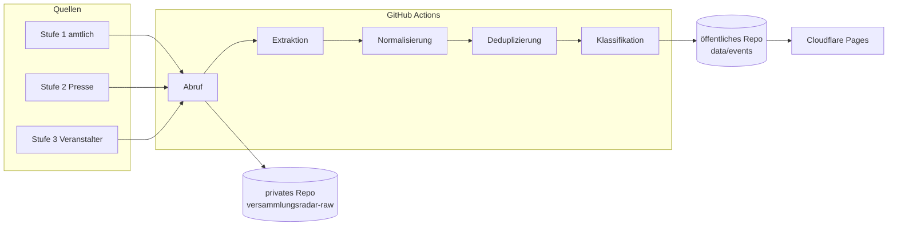

# Versammlungsradar: Architektur

Oct 6, 2026 · @Markus Possiel

## Ziel und Leitplanken

Der Versammlungsradar ist eine öffentliche, statische Website mit einem Zeitstrahl aller auffindbaren Versammlungen in Deutschland: zwölf Monate rückwirkend plus alle angemeldeten künftigen Termine, filterbar nach Bundesland, Kreis und Stadt. Ein GitHub-Actions-Job sammelt die Daten mehrmals täglich, Cloudflare Pages liefert die Seite aus.

Leitplanken für alle Bauphasen:

- **Neutralität:** Alle Versammlungen werden nach denselben Regeln erfasst, unabhängig von Thema oder politischer Richtung. Keine Bewertung, keine Kennzeichnung als „gut“ oder „gefährlich“.
- **Belegpflicht:** Jeder Eintrag verlinkt mindestens eine Quelle und zeigt, wie verlässlich sie ist (amtlich, Presse, Veranstalter).
- **Keine Personendaten:** Es werden Thema, Ort, Zeit und Organisation gezeigt, aber keine Namen privater Anmelder, Redner oder Teilnehmer.
- **Statisch und billig:** Kein eigener Server, keine Datenbank im Netz. Die Daten liegen als versionierte JSON-Dateien im Repo.

## Datenquellen

Es gibt kein bundesweites Register: Versammlungsrecht ist Ländersache, angezeigt wird bei der örtlichen Versammlungsbehörde. Der Radar kombiniert deshalb drei Quellenstufen und zeigt bei jedem Eintrag, aus welcher Stufe er stammt.

| Stufe | Quelle | Liefert | Verlässlichkeit | Abruf |
| --- | --- | --- | --- | --- |
| 1 Amtlich | Versammlungslisten von Polizei oder Stadt (bestätigt: [Polizei Berlin](https://www.berlin.de/polizei/service/versammlungsbehoerde/versammlungen-aufzuege/index.php), Pflicht nach § 8 VersFG BE) | Datum, Uhrzeit, Thema, PLZ, Ort, Aufzugsstrecke; Berlin aktualisiert zweimal täglich | Hoch | HTML-Tabelle parsen |
| 1 Amtlich | Allgemeinverfügungen, Pressemitteilungen von Städten und Polizei, Polizeimeldungen per RSS | Großlagen, Verbote, Teilnehmerzahlen im Nachgang | Hoch | RSS, HTML |
| 1 Amtlich | Antworten auf parlamentarische Anfragen | Rückblickende Listen mit Teilnehmerzahlen | Hoch, aber verzögert | PDF, nur für Rückblick |
| 2 Presse | Regionale Medien, Nachrichtenagenturen, Google-News-Abfragen je Stadt (Demo, Kundgebung, Mahnwache, Protest) | Ankündigungen und Berichte, Teilnehmerzahlen | Mittel | RSS, Such-API |
| 3 Veranstalter | Bündnis- und Organisationsseiten, iCal-Kalender, öffentliche Mastodon- und Bluesky-Konten | Aufrufe mit Ort und Zeit, oft früher als amtlich | Niedrig bis mittel, unbestätigt | iCal, offene APIs |

Drei Konsequenzen für die Architektur:

- **Historie muss selbst archiviert werden.** Amtliche Listen zeigen nur kommende Termine. Der Radar speichert ab Tag 1 jeden Abruf; das Vorjahr wird einmalig aus Wayback-Machine-Snapshots, Presse und parlamentarischen Antworten nachgebaut.
- **Abdeckung ist ungleich.** Großstädte mit eigener Liste sind dicht, ländliche Regionen nur über Presse sichtbar. Die Karte zeigt deshalb pro Region einen Abdeckungsgrad, damit Lücken nicht als „keine Demos“ gelesen werden.
- **Nicht jede Quelle darf maschinell gelesen werden.** Ein Testabruf von dresden.de wurde per robots.txt abgewiesen. Jede Quelle bekommt im Register ein Feld für erlaubten Abruf; gesperrte Quellen laufen nur manuell oder per Anfrage an die Behörde.

X, Instagram, Facebook und Telegram bleiben im MVP draußen: Die Plattform-AGB verbieten Scraping weitgehend, und offizielle APIs sind teuer oder eingeschränkt.

## Systemarchitektur



Alles läuft ohne eigenen Server: GitHub Actions holt und verarbeitet die Daten, Rohabrufe bleiben privat, nur geprüfte Ereignisse landen im öffentlichen Repo und von dort auf Cloudflare Pages.

## Datenmodell

Ein Ereignis ist eine Versammlung an einem Ort und Tag; mehrtägige Dauermahnwachen sind ein Ereignis mit Zeitraum. Jedes Ereignis sammelt alle Quellen, die es belegen, und leitet daraus Status und Konfidenz ab.

```json
{
  "id": "2026-10-11-berlin-10557-a3f9",
  "titel": "Kundgebung für sicheres Radfahren",
  "kategorie": "Verkehr",
  "form": "Aufzug",
  "start": "2026-10-11T14:00+02:00",
  "ende": "2026-10-11T18:00+02:00",
  "ort": {
    "bezeichnung": "Pariser Platz", "plz": "10117",
    "gemeinde": "Berlin", "ags": "11000000",
    "kreis": "Berlin", "bundesland": "BE",
    "lat": 52.5163, "lon": 13.3777, "genauigkeit": "platz"
  },
  "route": "Pariser Platz, Unter den Linden, Alexanderplatz",
  "veranstalter": "Organisation, nie Privatperson",
  "teilnehmer": { "angemeldet": 500, "polizei": null, "veranstalter": null },
  "status": "angezeigt",
  "konfidenz": 0.95,
  "quellen": [
    { "url": "https://…", "stufe": 1, "abgerufen": "2026-10-06T07:00Z" }
  ],
  "zuerst_gesehen": "2026-10-02",
  "zuletzt_gesehen": "2026-10-06"
}
```

Festlegungen:

- **Status** in fester Reihenfolge: angekündigt (nur Stufe 3) → angezeigt (Stufe 1) → verboten oder abgesagt → durchgeführt (nach dem Datum, belegt durch Presse oder Polizei) → unklar.
- **Kategorien** sind eine kleine, neutrale Themenliste (Arbeit, Klima, Frieden und Außenpolitik, Migration, Wohnen, Verkehr, Bildung, Gesundheit, Landwirtschaft, Sonstiges). Keine Lager- oder Richtungskennzeichnung.
- **Regionen** laufen über den Amtlichen Gemeindeschlüssel (AGS). Daraus ergeben sich Bundesland, Kreis und Gemeinde ohne eigene Pflege.
- **Speicher:** `data/events/2026/10.json` je Monat, `data/raw/<quelle>/<zeitstempel>` für jeden Rohabruf, `sources.yaml` als Quellenregister mit URL, Parser, Abrufintervall, robots-Status und Abdeckungsgebiet.

## Verarbeitung

Die Pipeline ist ein Python-Paket mit sieben Schritten; jeder Schritt liest und schreibt Dateien im Repo, damit jeder Lauf nachvollziehbar und wiederholbar bleibt.

1. **Abruf:** Ein Adapter pro Quelle aus `sources.yaml`. Er prüft robots.txt, hält ein Intervall von mindestens 1 Sekunde pro Host ein und speichert den Rohabruf unverändert.
2. **Extraktion:** Amtliche Tabellen laufen über feste Parser (kein LLM, keine Kosten, keine Halluzination). Presse- und Veranstaltertexte gehen an ein kleines Claude-Modell mit festem JSON-Schema; Kandidaten ohne Datum oder Ort werden verworfen.
3. **Normalisierung:** Zeiten nach ISO 8601 mit Zeitzone, Orte über Geocoding (Nominatim mit eigenem Cache, Limit 1 Anfrage pro Sekunde) und PLZ-zu-AGS-Zuordnung.
4. **Deduplizierung:** Erst Vorauswahl nach Tag und Gemeinde, dann Abgleich über Titelähnlichkeit, Entfernung unter 500 m und überlappende Uhrzeit. Nur unklare Paare entscheidet das LLM.
5. **Klassifikation:** Kategorie und Form aus der festen Liste per LLM; das Modell bekommt nur den Titel, keine Quelle, damit die Herkunft die Einordnung nicht färbt.
6. **Nachlauf:** Ab dem Tag nach dem Termin sucht der Job in Stufe-2-Quellen nach Berichten und setzt Status und Teilnehmerzahlen.
7. **Veröffentlichung:** Monatsdateien schreiben, Validierung gegen das Schema, Commit. Fällt die Validierung durch, bleibt die alte Version online.

## Frontend

Eine statische Seite (Astro oder Vite mit Vanilla JS) lädt nur die JSON-Dateien, die der aktuelle Filter braucht, und rechnet alles im Browser. Bei Zehntausenden Ereignissen pro Jahr reicht eine Aufteilung nach Monat und Bundesland, damit jede Datei unter 1 MB bleibt.

| Baustein | Inhalt | Technik |
| --- | --- | --- |
| Zeitstrahl | Balken pro Tag mit Anzahl, heute markiert, Zoom von Jahr auf Woche; Klick öffnet die Tagesliste | D3 oder schlichtes SVG |
| Karte | Punkte pro Ereignis, bei Zoom-out gebündelt; Aufzugsrouten als Linie, wenn vorhanden | MapLibre GL mit freien OSM-Kacheln (OpenFreeMap oder Protomaps) |
| Filter | Bundesland → Kreis → Stadt, Zeitraum, Kategorie, Status, Quellenstufe | URL-Parameter, damit jede Ansicht teilbar ist |
| Detailkarte | Titel, Zeit, Ort, Status, alle Quellen mit Stufe und Abrufdatum | Seitenpanel, mobil als Bottom Sheet |
| Abdeckung | Pro Kreis: amtliche Quelle ja/nein, Anzahl Quellen | Eigene Kartenebene, abschaltbar |
| Export | iCal- und RSS-Feed je Stadt oder Bundesland, CSV-Download | Beim Build erzeugt |
| Methodik | Quellen, Regeln, Lücken, Kontakt für Korrekturen | Statische Seite |

## Betrieb

Vier GitHub-Actions-Workflows reichen; jeder Commit ins Repo löst automatisch einen Cloudflare-Pages-Build aus.

| Workflow | Zeitplan (Europe/Berlin) | Aufgabe |
| --- | --- | --- |
| `ingest` | 07:00, 13:00, 19:00 | Alle Quellen abrufen, Schritte 1 bis 5, Commit |
| `nachlauf` | täglich 03:00 | Status vergangener Termine prüfen, Teilnehmerzahlen ergänzen |
| `health` | montags 06:00 | Quellen ohne Treffer seit drei Läufen oder mit Parserfehler als GitHub-Issue melden |
| `backfill` | einmalig, manuell | Vorjahr aus Wayback-Snapshots und Presse nachbauen |

- **Kosten:** Actions-Minuten sind für öffentliche Repos frei, Cloudflare Pages im Free-Plan ebenfalls. Laufende Kosten entstehen fast nur durch das LLM für Stufe 2 und 3; bei einem kleinen Modell grob einstellige Eurobeträge pro Monat (Schätzung, nach dem ersten Monat nachrechnen).
- **Secrets:** `ANTHROPIC_API_KEY` und ein fein granulierter GitHub-Token mit Schreibrecht nur auf das private Rohdaten-Repo als Repository-Secrets; nie im Code.
- **Bekannte Eigenheiten:** Geplante Actions starten zu Spitzenzeiten oft verspätet, und GitHub kann Zeitpläne in inaktiven öffentlichen Repos pausieren. Die automatischen Daten-Commits sollten das verhindern; der `health`-Job prüft es trotzdem.
- **Monitoring:** `data/health.json` mit letztem Erfolg, Trefferzahl und Fehler je Quelle, auf der Methodik-Seite öffentlich sichtbar.

## Recht und Ethik

Die wichtigste Architekturfolge: Rohdaten gehören nicht ins öffentliche Repo. Gespeicherte Presseartikel wären eine Vervielfältigung fremder Texte; sie liegen deshalb in einem privaten GitHub-Repo, öffentlich sind nur die extrahierten Fakten.

- **Urheberrecht:** Veröffentlicht werden Datum, Ort, Thema, Status und ein Link. Keine Artikeltexte, keine Bilder aus Quellen. Amtliche Bekanntmachungen sind nach § 5 UrhG freier, Presse nicht.
- **Datenschutz:** Keine Namen von Privatpersonen, auch wenn eine Quelle sie nennt. Veranstalter nur als Organisation. Kein Tracking; falls Statistik, dann cookielos (etwa Cloudflare Web Analytics).
- **Pflichtangaben:** Impressum und Datenschutzerklärung, da die Seite öffentlich ist.
- **Plattformregeln:** Nur offizielle APIs und Feeds; robots.txt und Nutzungsbedingungen je Quelle im Register festhalten.
- **Sicherheit der Teilnehmenden:** Gezeigt wird nur, was Behörden oder Veranstalter selbst öffentlich gemacht haben. Ein Korrektur- und Löschweg (Formular oder E-Mail) steht auf jeder Detailkarte, mit Reaktionsziel 48 Stunden.
- **Haftung:** Klarer Hinweis, dass Angaben ohne Gewähr sind und die amtliche Quelle maßgeblich ist.

Das ist keine Rechtsberatung; Impressum, Datenschutzerklärung und der Umgang mit Stufe-3-Quellen sollten vor dem Start einmal juristisch geprüft werden.

## Bauphasen

Gebaut wird von innen nach außen: erst eine Stadt sauber Ende zu Ende, dann Breite. Jede Phase hat ein Abnahmekriterium und einen Startauftrag, den du direkt an Claude Code (Sonnet reicht) geben kannst.

1. **MVP Berlin.** Datenmodell, Berlin-Parser, `ingest`-Workflow, Zeitstrahl und Karte, Deploy auf Cloudflare Pages.
   - Abnahme: 14 Tage Läufe ohne Fehler, jeder Eintrag der Berliner Liste erscheint.
   - Auftrag: „Lies ARCHITEKTUR.md. Baue den Berlin-Adapter samt pytest gegen einen gespeicherten Snapshot, dann den ingest-Workflow.“
2. **Quellenregister.** Alle Landeshauptstädte und Städte über 100.000 Einwohner auf amtliche Listen, Pressestellen und RSS prüfen; Parser für jede gefundene Liste.
   - Abnahme: Abdeckungskarte zeigt für jede dieser Städte einen Status.
   - Auftrag: „Prüfe für jede Stadt in staedte.csv, ob die Versammlungsbehörde Termine veröffentlicht, und trage URL, Format und robots-Status in sources.yaml ein.“
3. **Presse-Schicht.** LLM-Extraktion, Geocoding, Deduplizierung, `nachlauf`.
   - Abnahme: Stichprobe von 50 Einträgen mit weniger als 10 % Fehlern bei Datum, Ort oder Dublette.
4. **Rückblick.** Einmaliger `backfill` für die letzten zwölf Monate.
   - Abnahme: Für Berlin stimmen die Monatssummen grob mit den Zahlen aus parlamentarischen Antworten überein.
5. **Veranstalter-Schicht und Launch.** Stufe-3-Quellen, Feeds, Methodik-Seite, Rechtscheck, öffentliche Domain.
   - Abnahme: Impressum, Datenschutz und Korrekturweg live.

## Entscheidungen

Alle fünf offenen Punkte sind entschieden (Stand 6. Oktober 2026).

| Thema | Entscheidung | Folge für den Bau |
| --- | --- | --- |
| Rohdaten | Privates GitHub-Repo, z. B. `versammlungsradar-raw` | Der Job im öffentlichen Repo pusht mit einem fein granulierten Token. Rohabrufe gzip-komprimiert und nur bei geändertem Inhalt speichern, damit das Repo klein bleibt. |
| Code-Repo | Öffentlich | Actions-Minuten frei; Pipeline und Regeln sind für alle nachprüfbar. |
| Stufe 3 | Sofort sichtbar | Kennzeichnung „unbestätigt“, gestrichelter Kartenpunkt, Filter zum Ausblenden. Der Korrekturweg muss ab Tag 1 live sein. |
| Lizenz | Ereignisdaten CC BY 4.0, Code MIT | Begründung unten. |
| Domain | versammlungsradar.de ist frei | Registrieren, dazu protestradar.de als Weiterleitung. |

**Lizenz:** CC BY 4.0 für die Ereignisdaten. Jeder darf sie weiterverwenden, muss aber „Versammlungsradar“ als Quelle nennen. Version 4.0 deckt ausdrücklich auch das Datenbankherstellerrecht (§ 87a UrhG) ab, das bei einer gepflegten Sammlung greifen kann. Die Lizenz gilt nur für die eigenen Felder; verlinkte Presseartikel bleiben bei ihren Rechteinhabern. Alternative wäre ODbL wie bei OpenStreetMap, die abgeleitete Datensätze ebenfalls offen hält, Medien und Forschung aber eher abschreckt.

**Domain (DENIC-RDAP, 6. Oktober 2026):**

| Domain | Status |
| --- | --- |
| versammlungsradar.de | frei |
| protestradar.de | frei |
| kundgebungsradar.de | frei |
| versammlungsatlas.de | frei |
| versammlungsticker.de | frei |
| demoradar.de | vergeben |
| demo-radar.de | vergeben |
| versammlungskalender.de | vergeben |

Entschieden: versammlungsradar.de als Hauptdomain, protestradar.de als kurze Weiterleitung. Für versammlungsradar.org und .eu lieferte die Abfrage ebenfalls keinen Eintrag; das beim Registrar bestätigen.

## Quellen

- [Polizei Berlin: Versammlungen und Aufzüge](https://www.berlin.de/polizei/service/versammlungsbehoerde/versammlungen-aufzuege/index.php)
- [Abgeordnetenhaus Berlin: Wortprotokoll zur Veröffentlichungspflicht nach § 8 VersFG BE](https://pardok.parlament-berlin.de/starweb/adis/citat/VT/19/AusschussPr/iso/iso19-037-ip.pdf)
- [Abgeordnetenhaus Berlin: Drucksache 19/25990, Versammlungen 30. April bis 1. Mai 2026](https://pardok.parlament-berlin.de/starweb/adis/citat/VT/19/SchrAnfr/S19-25990.pdf)
